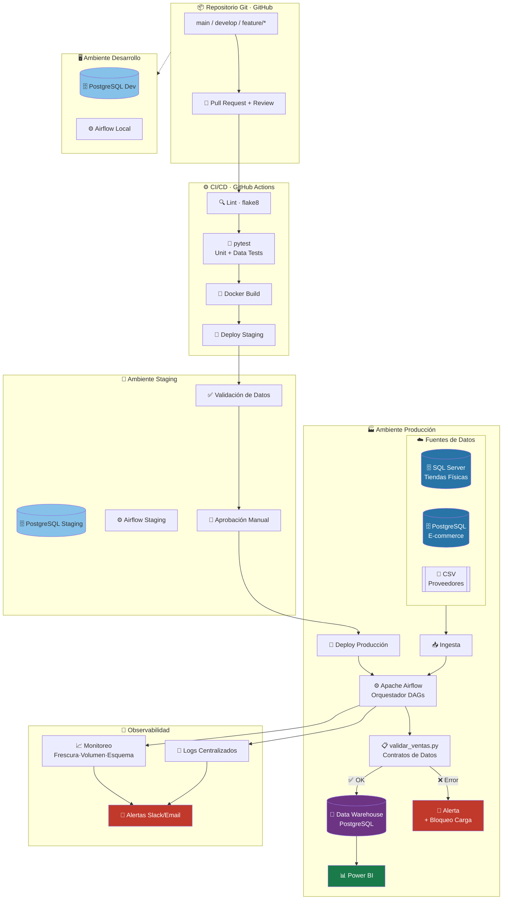

# 📋 Informe Técnico: DevOps en la Arquitectura de Datos de AndesMercado

---

> **Estudio de Caso:** Incidente de Integridad de Datos — Black Friday 2025
> **Empresa:** AndesMercado S.A.S.
> **Fecha del Incidente:** 27 Nov – 3 Dic 2025
> **Autor:** Equipo de Arquitectura y DataOps
> **Versión:** 1.0
> **Clasificación:** Interno — Uso Restringido

---

## 📑 Índice

1. [Resumen Ejecutivo](#resumen-ejecutivo)
2. [Parte 1 — Diagnóstico CALMS](#-parte-1-diagnóstico-calms)
3. [Parte 2 — Causa Raíz y Postmortem](#-parte-2-causa-raíz-y-postmortem)
4. [Parte 3 — Arquitectura Objetivo](#-parte-3-arquitectura-objetivo)
5. [Parte 4 — Implementación Python: Validación Automatizada](#-parte-4-implementación-python-validación-automatizada)
6. [Parte 5 — Métricas DORA y Plan de Adopción](#-parte-5-métricas-dora-y-plan-de-adopción)

---

## 🔍 Resumen Ejecutivo

AndesMercado opera 45 tiendas físicas y un canal de e-commerce en crecimiento. Su arquitectura de datos, aunque funcional en sus inicios, fue diseñada para un contexto de menor escala y complejidad: tres fuentes heterogéneas (SQL Server, PostgreSQL y archivos CSV) convergen en un único servidor virtual mediante scripts Python ejecutados por `cron` a las 2:00 a.m., depositando los resultados en una base de datos PostgreSQL que alimenta tableros de Power BI.

Durante el Black Friday de 2025, esta arquitectura frágil colapsó ante un cambio no coordinado de esquema en el sistema de e-commerce. La columna `monto` fue convertida de pesos colombianos (COP) a centavos sin notificación alguna al equipo de datos. El script nocturno procesó los valores sin validación, inflando las ventas en línea 100 veces. El tablero mostró un crecimiento del +9.800% que fue interpretado erróneamente como éxito comercial, desencadenando una compra de inventario de COP 850 millones. Cuando se detectó el error días después, el intento de corrección directa en producción propagó el daño a los datos de tiendas físicas, dejando el sistema fuera de servicio durante dos días completos.

Este informe realiza un diagnóstico profundo mediante el marco CALMS, reconstruye la cadena causal mediante análisis de los 5 Porqués y un postmortem blameless, propone una arquitectura objetivo con prácticas DevOps maduras, documenta la implementación de validación automatizada que habría prevenido el incidente, y establece un plan de adopción medible basado en métricas DORA.

---

## 🏛️ Parte 1: Diagnóstico CALMS

### 1.1 Evaluación de los Cinco Pilares CALMS

El marco CALMS (Cultura, Automatización, Lean, Medición, Compartir) es el estándar de referencia para evaluar la madurez DevOps de una organización. A continuación se presenta la evaluación de AndesMercado con base en la evidencia directa del caso:

| Pilar | Calificación (1–5) | Evidencia del Caso | Justificación |
|---|---|---|---|
| **Cultura** | ⭐ 1/5 | El equipo de e-commerce modificó el esquema de datos sin notificar al ingeniero de datos. No existe ninguna cultura de responsabilidad compartida sobre los datos. | Los cambios de alto impacto se hacen de forma aislada. No hay reuniones de coordinación técnica entre equipos, ni acuerdos de API/contrato de datos. La responsabilidad recae en un solo individuo (Andrés), lo que crea un cuello de botella cultural y un punto único de fallo humano. |
| **Automatización** | ⭐ 1/5 | El único proceso automatizado es un `cron` que ejecuta un script Python. No hay pruebas automatizadas, ni validación de esquema, ni CI/CD. | El script no valida tipos de datos, rangos ni integridad de las fuentes antes de cargar. La "automatización" existente es meramente operativa: mueve datos, pero no los verifica. La corrección del incidente requirió intervención manual directa sobre producción. |
| **Lean** | ⭐⭐ 2/5 | El flujo de despliegue tarda 3 semanas y el 40% de los despliegues causan errores. | Existe una cadencia de despliegue (una vez al mes), lo cual es un proceso, aunque ineficiente. Sin embargo, el desperdicio es masivo: errores frecuentes, tiempo de detección de 2–5 días y tiempo de corrección de 1–2 días revelan ciclos de retroalimentación extremadamente lentos. No hay batches pequeños ni entrega continua. |
| **Medición** | ⭐ 1/5 | El tablero de Power BI mostró +9.800% en ventas y no generó ninguna alerta ni advertencia. No existen métricas de calidad de datos, umbrales de anomalía ni SLAs definidos. | La ausencia de observabilidad significa que el sistema no sabe cuándo está fallando. El único "monitor" era el ojo humano revisando el tablero, y ese mecanismo tampoco funcionó porque no había contexto histórico comparativo disponible en tiempo real para quien lo observaba. |
| **Compartir** | ⭐ 1/5 | No existe Git, no hay repositorio de código, no hay documentación técnica del pipeline, no hay runbooks. El conocimiento reside exclusivamente en la memoria de Andrés Rojas. | Si Andrés se va de vacaciones, enferma o renuncia, la operación de datos de AndesMercado se detiene por completo. No hay transferencia de conocimiento, no hay wikis internas, no hay postmortems previos documentados. |

**Calificación Global: 1.2 / 5 — Madurez DevOps Inicial (Nivel 1)**

---

### 1.2 Pilar Más Débil: Cultura (1/5)

Aunque cuatro de los cinco pilares reciben la calificación mínima, el pilar de **Cultura** es el más crítico y el que actúa como raíz de todos los demás fallos. Esta afirmación se sustenta en la siguiente lógica:

La **automatización** no existe porque nadie en la organización ha definido como prioritario implementarla. La **medición** es inexistente porque no hay una cultura que exija responsabilidad sobre los datos. El conocimiento no se **comparte** porque la cultura organizacional no lo incentiva ni lo requiere. Los procesos no son **lean** porque el equipo trabaja de manera reactiva, no proactiva.

El evento detonante del incidente —el cambio de esquema sin notificación— es un síntoma cultural, no técnico. El equipo de e-commerce no sabía (o no consideró relevante) que modificar la columna `monto` afectaría a otro sistema. Esto revela la ausencia del concepto de **responsabilidad colectiva sobre los datos** (*data ownership*), que es la piedra angular de cualquier cultura DataOps.

---

### 1.3 Análisis del Fallo de Comunicación: Dimensión Técnica vs. Cultural

El fallo de comunicación del incidente opera en dos planos simultáneos que se refuerzan mutuamente:

**Dimensión Técnica:**
No existía ningún mecanismo técnico que obligara o facilitara la comunicación entre equipos ante cambios de esquema. No había contratos de datos (*data contracts*) formalizados, no había versionado de esquema (*schema registry*), no había pruebas de contrato (*contract testing*), y el pipeline no validaba la consistencia de las fuentes entrantes. Desde una perspectiva técnica, el sistema estaba diseñado para fallar silenciosamente: procesaba lo que recibía sin cuestionar si era correcto.

**Dimensión Cultural:**
Más profundamente, el problema es que ningún miembro del equipo de e-commerce consideró necesario comunicar el cambio. Esto sugiere que en AndesMercado no existe una cultura de *change management* transversal. Los equipos operan en silos: el equipo de e-commerce es responsable de su aplicación, el equipo de datos es responsable de su pipeline, y nadie es responsable de la interfaz entre ambos. Esta mentalidad de silo es incompatible con una arquitectura de datos integrada.

La solución requiere **ambas dimensiones**: implementar contratos de datos y validaciones técnicas (para que el sistema falle rápido y de manera visible), y simultáneamente construir una cultura de comunicación entre equipos (para que los cambios de alto impacto sean coordinados, no unilaterales). La técnica sin cultura solo genera fricción; la cultura sin técnica solo genera promesas.

---

## 🔎 Parte 2: Causa Raíz y Postmortem

### 2.1 Análisis de los 5 Porqués

El análisis de los 5 Porqués (*5 Whys*) es una técnica de causa raíz que evita quedarse en los síntomas superficiales del problema. Se parte del síntoma principal y se pregunta "¿por qué?" de manera recursiva hasta alcanzar la causa sistémica.

**Síntoma (punto de partida):** La gerencia compró COP 850 millones en inventario con base en datos erróneos.

---

**¿Por qué 1?** ¿Por qué los datos en el tablero eran erróneos?
> Porque el script de carga nocturna ingirió datos de e-commerce donde la columna `monto` había sido cambiada de pesos a centavos, sin que ninguna validación lo detectara.

**¿Por qué 2?** ¿Por qué el script no detectó el cambio de unidad?
> Porque el script no tenía ninguna lógica de validación de rangos, tipos ni contratos de datos. Simplemente copiaba los valores de la fuente al destino sin verificación.

**¿Por qué 3?** ¿Por qué el script no tenía validaciones?
> Porque fue desarrollado por un único ingeniero, en ausencia de estándares de desarrollo, sin revisión de código, sin pruebas automatizadas y sin un proceso formal de aseguramiento de calidad de datos.

**¿Por qué 4?** ¿Por qué no existían estándares de desarrollo ni revisión de código?
> Porque la organización no tiene una práctica de ingeniería de datos formalizada: no usa control de versiones (Git), no tiene ambientes separados (dev/staging/prod), y el trabajo de datos es tratado como operacional, no como ingeniería de software.

**¿Por qué 5?** ¿Por qué la ingeniería de datos no está formalizada?
> **Causa Raíz:** Porque la organización nunca ha establecido una cultura de responsabilidad técnica compartida sobre los datos ni ha invertido en prácticas DevOps/DataOps. La función de datos fue construida de manera orgánica, ad hoc, por una sola persona, sin gobernanza, sin documentación y sin participación de liderazgo en la definición de estándares técnicos.

---

### 2.2 Mapeo del Incidente con Prácticas DevOps Preventivas

Cada fase del incidente correspondió a una brecha de práctica DevOps específica. La siguiente tabla muestra el mapeo y la práctica que habría evitado el daño:

| Fase del Incidente | Qué ocurrió | Práctica DevOps ausente | Cómo lo habría evitado |
|---|---|---|---|
| **Jue 27 Nov 18:00** | E-commerce cambia `monto` a centavos sin notificar | Contratos de datos + Change Management | Un contrato de datos formalizado habría requerido notificación previa y aprobación del equipo de datos antes de cualquier cambio en columnas compartidas |
| **Vie 28 Nov 02:00** | Script nocturno ingiere datos inflados sin error | Validación de datos en pipeline (Data Quality Rules) | Las reglas R4 (monto > 5M) y R5 (anomalía estadística diaria) habrían bloqueado la carga y generado una alerta inmediata |
| **Vie 28 Nov 08:00** | Tablero muestra +9.800% sin alerta | Observabilidad + Monitoreo de anomalías | Un sistema de monitoreo habría detectado la desviación estadística y enviado alerta a Slack/email antes de que nadie viera el tablero |
| **Vie 28 Nov 11:00** | Gerencia aprueba compra de COP 850M | Cultura de verificación de datos + SLA de calidad | Un proceso de validación pre-decisión y un tablero con indicadores de calidad de datos habrían generado fricción antes de la decisión |
| **Lun 1 Dic 16:00** | Andrés modifica script directamente en producción | Control de versiones + Ambientes separados + CI/CD | Con Git y un flujo de PR + CI/CD, ningún cambio podría aplicarse a producción sin pasar por dev, staging, pruebas y aprobación |
| **Mar 2 Dic 02:00** | Script aplica división errónea a tiendas físicas | Pruebas unitarias + Pruebas de integración | Las pruebas habrían verificado que la lógica de corrección aplica únicamente al canal afectado (`en_linea`), no a todos los canales |
| **Mié 3 Dic** | Restauración manual desde respaldo, 2 días fuera | Automatización de backups + Runbooks documentados | Un proceso de recuperación documentado y probado habría reducido el tiempo de restauración de 2 días a horas |

---

### 2.3 Postmortem Blameless — Cronología del Incidente

El postmortem blameless es una práctica fundamental de la cultura SRE (Site Reliability Engineering). Su premisa es que los incidentes son el resultado de fallos sistémicos, no de errores individuales. La persona involucrada (en este caso Andrés) actuó de buena fe dentro de un sistema que no estaba diseñado para prevenir el fallo. El objetivo es mejorar el sistema, no culpar a las personas.

#### Cronología Visual del Incidente

```mermaid
timeline
    title Cronología del Incidente — Black Friday AndesMercado 2025
    section Jueves 27 Nov
        18:00 : E-commerce despliega cambio de esquema
              : monto pasa de pesos a centavos
              : Sin notificación al equipo de datos
    section Viernes 28 Nov
        02:00 : Script nocturno ejecuta sin errores
              : Ventas en línea 100x infladas en warehouse
        08:00 : Tablero muestra +9800% en ventas en línea
              : Gerente comercial interpreta como éxito
        11:00 : Aprobada compra de inventario COP 850M
    section Lunes 1 Dic
        10:00 : Finanzas detecta discrepancia con bancos
        16:00 : Andrés corrige script en producción
              : Divide monto entre 100 para todos los canales
    section Martes 2 Dic
        02:00 : Script aplica división a tiendas físicas
              : Ventas físicas aparecen 100x menores
    section Miércoles 3 Dic
        00:00 : Restauración manual desde respaldo
              : Tableros fuera de servicio — 2 días de impacto
```

#### Hallazgos del Postmortem

**¿Qué salió bien?**
- El equipo de Finanzas detectó la discrepancia al comparar con registros bancarios reales, demostrando que los controles financieros existentes funcionaron como red de seguridad final.
- Existía un respaldo manual que permitió la eventual recuperación del sistema.

**¿Qué salió mal?**
- El pipeline de datos no tenía ningún mecanismo de detección de cambios de esquema ni validación de rangos.
- No existía ningún proceso de coordinación entre el equipo de e-commerce y el equipo de datos para cambios de alto impacto.
- El único ingeniero de datos no tenía a quién escalar, ni procedimientos documentados para la recuperación de incidentes.
- La corrección fue realizada bajo presión, sin entorno de prueba, lo que propagó el daño.
- El tiempo transcurrido entre el incidente (Vie 28 Nov 02:00) y la detección (Lun 1 Dic 10:00) fue de **más de 72 horas**, durante las cuales se tomaron decisiones críticas de negocio con datos corruptos.

**Acciones correctivas (con propietario y fecha):**

| Acción | Propietario | Fecha Límite |
|---|---|---|
| Implementar contrato de datos para tabla `ventas` | Andrés + Tech Lead e-commerce | Semana 1 |
| Instalar validaciones R4 y R5 en pipeline de producción | Andrés | Semana 2 |
| Crear repositorio Git con historial del pipeline | Andrés + CTO | Semana 1 |
| Definir ambiente de staging separado | Infraestructura | Semana 3 |
| Configurar alertas de anomalías en Slack | Andrés | Semana 2 |
| Documentar runbook de recuperación de incidentes | Andrés | Semana 4 |
| Crear segundo ingeniero de datos (buddy system) | RRHH + CTO | Mes 2 |

---

## 🏗️ Parte 3: Arquitectura Objetivo

### 3.1 Diagrama de Arquitectura Propuesta

La arquitectura objetivo transforma el pipeline monolítico y frágil de AndesMercado en un sistema robusto, observable y gobernado, con separación clara de ambientes, automatización de calidad de datos y trazabilidad completa de cambios.



---

### 3.2 Flujo de Trabajo Detallado: Commit → Producción

El siguiente flujo describe el ciclo de vida completo de un cambio en el pipeline de datos, desde que un desarrollador escribe código hasta que llega a producción:

**Paso 1 — Desarrollo Local**
El ingeniero de datos crea una rama `feature/validacion-monto` a partir de `develop`. Instala las dependencias con `pip install -r requirements.txt` en su entorno virtual. Desarrolla y prueba localmente contra `PostgreSQL Dev` con datos sintéticos representativos.

**Paso 2 — Commit y Push**
Al hacer `git push origin feature/validacion-monto`, el repositorio en GitHub recibe los cambios. El desarrollador abre un *Pull Request* hacia `develop`, describe los cambios, las reglas añadidas y el impacto esperado.

**Paso 3 — Pipeline de CI (GitHub Actions)**
Automáticamente se ejecuta el workflow `.github/workflows/ci.yml`:
- `flake8` verifica el estilo y detecta errores de sintaxis.
- `pytest` ejecuta pruebas unitarias y pruebas de calidad de datos con datos de prueba.
- Si alguna prueba falla, el PR no puede ser aprobado (*branch protection rule*).

**Paso 4 — Revisión de Código**
Un segundo ingeniero (o el tech lead) revisa el PR. La revisión incluye verificar que las nuevas reglas de validación son correctas, que no introducen regresiones y que están documentadas. Se requiere al menos una aprobación para hacer *merge*.

**Paso 5 — Despliegue a Staging**
Al hacer *merge* a `develop`, el pipeline de CD despliega automáticamente la nueva versión del pipeline a **Ambiente Staging**. Se ejecutan los DAGs de Airflow en staging con una copia reciente de los datos de producción (anonimizados). Se generan reportes de validación de datos.

**Paso 6 — Aprobación Manual para Producción**
El encargado de datos revisa el reporte de staging y aprueba manualmente el despliegue a producción. Esta aprobación queda registrada en GitHub con timestamp y usuario.

**Paso 7 — Despliegue a Producción**
Al hacer *merge* de `develop` a `main`, el pipeline despliega a producción con imagen Docker versionada. Apache Airflow orquesta los DAGs. Las validaciones de datos se ejecutan en tiempo real antes de cualquier carga al Data Warehouse.

**Paso 8 — Monitoreo Post-Despliegue**
Durante las primeras 24 horas tras el despliegue, el sistema de observabilidad emite alertas de cualquier anomalía de fresura, volumen o esquema. Si se detecta un problema, el runbook establece el procedimiento de rollback, que consiste en hacer `git revert` y redesplegar la imagen anterior.

---

### 3.3 Contrato de Datos: Tabla `ventas`

Un contrato de datos es un acuerdo formal entre el productor de datos (equipo de e-commerce) y el consumidor (equipo de datos/pipeline). Define de manera inequívoca la estructura, tipos, unidades y restricciones de los datos, y establece compromisos de notificación ante cambios.

#### Especificación del Contrato

**Versión:** v1.0 | **Fecha de vigencia:** 2026-01-01 | **Partes:** Equipo E-commerce (productor) ↔ Equipo Data (consumidor)

| Campo | Tipo SQL | Descripción | Unidad | Rango Válido | Nulable | Ejemplo |
|---|---|---|---|---|---|---|
| `id_venta` | `BIGINT` | Identificador único de la transacción | — | > 0 | No | 1012 |
| `fecha` | `DATE` | Fecha de la transacción | YYYY-MM-DD | 2020-01-01 a hoy+1 | No | 2025-11-28 |
| `canal` | `VARCHAR(20)` | Canal de venta | — | `en_linea`, `tienda` | No | `en_linea` |
| `id_tienda` | `INTEGER` | ID de tienda (NULL para en línea) | — | 1–45 | Sí (en línea) | 7 |
| `id_producto` | `INTEGER` | SKU del producto | — | > 0 | No | 3821 |
| `cantidad` | `INTEGER` | Unidades vendidas | Unidades | 1–9.999 | No | 3 |
| `monto` | `DECIMAL(15,2)` | Valor total de la transacción | **Pesos colombianos (COP)** | 100 – 5.000.000 | No | 189900.00 |
| `id_cliente` | `BIGINT` | ID del cliente (NULL si anónimo) | — | > 0 | Sí | 48291 |
| `created_at` | `TIMESTAMP` | Timestamp de creación del registro | UTC | — | No | 2025-11-28T14:32:00Z |

#### SLA de Notificación de Cambios

> **CRÍTICO:** Cualquier cambio en los campos `monto`, `canal`, `fecha` o en la clave primaria `id_venta` requiere:
> 1. Notificación escrita al equipo de datos con **mínimo 5 días hábiles de anticipación**.
> 2. Aprobación formal del Tech Lead de Datos.
> 3. Despliegue coordinado en la misma ventana de mantenimiento.
> 4. Período de migración de **al menos 2 semanas** con ambas versiones disponibles en paralelo (campo legado + campo nuevo).

**Acuerdos de Calidad:**
- El productor garantiza que `monto` **siempre** estará expresado en **Pesos Colombianos (COP) enteros con dos decimales**.
- El productor garantiza disponibilidad del endpoint de datos antes de las 01:30 a.m. (hora Colombia) para permitir la ingesta nocturna.
- El consumidor debe notificar al productor si detecta anomalías en los datos en un plazo máximo de 1 hora después de la detección.

---

### 3.4 Infraestructura como Código (IaC)

La gestión de infraestructura mediante código es esencial para garantizar reproducibilidad, trazabilidad y la eliminación del "funciona en mi máquina". Para AndesMercado se propone el siguiente esquema con dos herramientas complementarias:

#### Docker Compose — Entornos Locales y Staging

**Responsabilidad:** Orquestar los servicios de la plataforma de datos en entornos de desarrollo y staging de manera idéntica y reproducible.

**Servicios gestionados:**
- `airflow-webserver` y `airflow-scheduler` (versión fijada, e.g., `apache/airflow:2.8.1`)
- `postgres-dw` — base de datos del Data Warehouse en staging/dev
- `postgres-airflow` — base de datos de metadatos de Airflow
- `redis` — broker de mensajes para Airflow CeleryExecutor
- `pgadmin` — herramienta de administración (solo dev)

**Beneficio clave:** El archivo `docker-compose.yml` vive en el repositorio Git. Cualquier miembro del equipo puede levantar un entorno completo y funcional con un único comando (`docker compose up -d`), sin instalaciones manuales ni configuraciones ad hoc.

#### Terraform — Infraestructura en la Nube

**Responsabilidad:** Provisionar y gestionar la infraestructura en el proveedor de nube (AWS, GCP o Azure) de manera declarativa.

**Recursos gestionados con Terraform:**
- Instancias de cómputo (VM o ECS/Cloud Run) para Airflow en staging y producción
- Base de datos RDS/Cloud SQL para el Data Warehouse de producción, con configuración de backups automáticos y réplica de lectura
- Grupos de seguridad y reglas de red (firewall rules)
- Bucket de almacenamiento (S3/GCS) para logs de Airflow y archivos CSV
- Secretos en AWS Secrets Manager / GCP Secret Manager (credenciales de bases de datos, tokens de API)
- Sistema de alertas (SNS/Cloud Monitoring) conectado a Slack

**Beneficio clave:** El estado de la infraestructura está versionado (`terraform.tfstate` en backend remoto). Cualquier cambio de infraestructura requiere un plan (`terraform plan`) que muestra exactamente qué se va a modificar antes de aplicarlo, eliminando los cambios sorpresa en producción.

---

### 3.5 Los 5 Pilares de Observabilidad y el Incidente

La observabilidad no es un lujo: es el mecanismo que convierte los fallos inevitables en incidentes detectables y manejables. Los cinco pilares de observabilidad aplicados al contexto de AndesMercado son:

**Pilar 1 — Métricas**
Indicadores numéricos continuos sobre el estado del pipeline. Para AndesMercado, las métricas críticas son: número de registros ingresados por canal y fecha, suma total de `monto` por canal y fecha, latencia del DAG de ingesta, y tasa de error de validación.
*¿Cómo habría detectado el incidente?* Una métrica de `suma_monto_en_linea` comparada con el promedio histórico de los últimos 30 días habría generado una alerta automática al superar el umbral (e.g., >3 desviaciones estándar), exactamente lo que hace la regla R5 a las 02:01 a.m. del 28 de noviembre.

**Pilar 2 — Logs**
Registros estructurados y centralizados de cada ejecución del pipeline. Cada paso del DAG de Airflow debe emitir logs con contexto: `{dag_id, run_id, task_id, records_processed, records_rejected, timestamp}`.
*¿Cómo habría detectado el incidente?* Los logs habrían registrado explícitamente cuántos registros fueron rechazados por las reglas R4 y R5, con los valores exactos que violaron los contratos. El equipo habría visto `WARN: 3 registros superan umbral de COP 5M` en el log de las 02:00 a.m.

**Pilar 3 — Trazas (Traces)**
Seguimiento del recorrido completo de un dato desde la fuente hasta el tablero. Con instrumentación de trazas, es posible responder: "¿de dónde vino este valor de monto = 4.599.000 COP?" y navegar hasta el registro original en el sistema de e-commerce.
*¿Cómo habría detectado el incidente?* Habría permitido identificar en minutos que los valores inflados provenían exclusivamente del canal `en_linea`, aislando el problema y evitando la corrección errónea que afectó a las tiendas físicas.

**Pilar 4 — Alertas**
Notificaciones automáticas y accionables enviadas al canal correcto (Slack, email, PagerDuty) cuando una métrica supera un umbral o un log registra un evento de error. Las alertas deben ser contextuales: indicar qué falló, en qué DAG, con qué valores y qué acción tomar.
*¿Cómo habría detectado el incidente?* A las 02:03 a.m. del 28 de noviembre, Andrés habría recibido un mensaje de Slack: "🚨 ALERTA: Validación fallida en ingesta de ventas. Canal `en_linea`, fecha `2025-11-28`: monto promedio = COP 23.4M (esperado < COP 5M). Carga bloqueada. Ver log: [link]". El tablero nunca habría mostrado datos incorrectos.

**Pilar 5 — Dashboards de Salud del Pipeline**
Tableros dedicados no al negocio, sino a la salud del sistema de datos. Separar el "tablero de ventas" (para gerencia) del "tablero de operaciones de datos" (para el equipo técnico). Este último muestra: estado de los DAGs, freshness de los datos, conteo de registros rechazados, tiempo de ejecución de cada tarea.
*¿Cómo habría detectado el incidente?* El tablero de operaciones habría mostrado en rojo el DAG de ingesta de e-commerce con el estado "BLOQUEADO — validación fallida", visible para cualquier miembro del equipo desde las 02:00 a.m., sin necesidad de que nadie revisara el tablero de Power BI.

---

## 🐍 Parte 4: Implementación Python — Validación Automatizada

La implementación técnica de las reglas de validación (contenida en los archivos `validar_ventas.py` y `test_validaciones.py` del repositorio) constituye la primera línea de defensa del pipeline de datos de AndesMercado.

Las dos reglas críticas, ya implementadas y probadas sobre el CSV del caso, producen los siguientes resultados:

- **Regla R4 — Monto Máximo por Transacción (umbral: COP 5.000.000):** **FALLA**. Los registros con `id_venta` 1012 (COP 18.990.000), 1013 (COP 45.990.000) y 1014 (COP 8.990.000) superan el límite establecido en el contrato de datos. Estos tres registros habrían sido rechazados y puestos en cuarentena antes de llegar al Data Warehouse.

- **Regla R5 — Anomalía Estadística Diaria (umbral: 3x el promedio histórico):** **FALLA**. El canal `en_linea` el día 28 de noviembre presenta un ratio de **156.16x** respecto al promedio de los días anteriores. Esta desviación, 52 veces superior al umbral de alerta, habría bloqueado la carga completa del lote e iniciado una alerta automática.

**Conclusión clave:** Con ambas reglas activas en el pipeline, el error **nunca habría llegado al tablero de Power BI**. La decisión de compra de COP 850 millones no habría podido tomarse con datos corruptos porque los datos corruptos nunca habrían sido escritos en el Data Warehouse.

---

## 📊 Parte 5: Métricas DORA y Plan de Adopción

### 5.1 Métricas DORA — Estado Actual vs. Meta

Las métricas DORA (DevOps Research and Assessment) son el estándar de la industria para medir el rendimiento de equipos de ingeniería. Fueron desarrolladas por el equipo de Google DORA tras analizar más de 30.000 organizaciones durante una década. Se dividen en cuatro métricas que capturan tanto la velocidad como la estabilidad de un equipo.

| Métrica DORA | Valor Actual AndesMercado | Clasificación Actual | Meta a 6 Meses | Clasificación Objetivo |
|---|---|---|---|---|
| **Frecuencia de Despliegue** | 1 vez/mes | 🔴 Low (Bajo) | 1 vez/semana | 🟡 Medium (Medio) |
| **Lead Time para Cambios** | 3 semanas | 🔴 Low (Bajo) | 3–5 días | 🟡 Medium (Medio) |
| **Tasa de Fallos en Cambios** | 40% (4/10 despliegues) | 🔴 Low (Bajo) | < 15% | 🟡 Medium (Medio) |
| **Tiempo de Restauración** | 1–2 días | 🔴 Low (Bajo) | < 4 horas | 🟡 Medium (Medio) |

**Referencia de Clasificación DORA (State of DevOps Report 2024):**

| Clasificación | Frecuencia de Despliegue | Lead Time | Tasa de Fallos | Tiempo de Restauración |
|---|---|---|---|---|
| 🟢 Elite | Múltiples/día | < 1 hora | < 5% | < 1 hora |
| 🟡 High | 1/semana–1/mes | 1 día – 1 semana | < 10% | < 1 día |
| 🟠 Medium | 1/semana–1/mes | 1 semana – 1 mes | 10–15% | < 1 día |
| 🔴 Low | < 1/mes | > 1 mes | > 15% | > 1 día |

> **Nota estratégica:** El objetivo a 6 meses es pasar de **Low** a **Medium** en todas las métricas. Aspirar a Elite en el primer año sería irrealista dado el punto de partida. El movimiento de Low a Medium es el que genera el mayor impacto en estabilidad y confianza organizacional.

---

### 5.2 Plan de Adopción — 90 Días en 3 Fases

#### 🏗️ Fase 1 (Días 1–30): Fundamentos y Contención

**Objetivo:** Eliminar los puntos de fallo más críticos y establecer los fundamentos técnicos.

| Entregable | Descripción | Responsable | Semana |
|---|---|---|---|
| Repositorio Git inicializado | Migrar el código existente del script cron a GitHub. Rama `main` protegida. | Andrés + CTO | S1 |
| Contrato de datos `ventas` firmado | Documento aprobado por e-commerce y equipo de datos | Andrés + Tech Lead Ecommerce | S1 |
| Reglas R4 y R5 en producción | Validaciones instaladas en el pipeline actual (sin refactorización completa) | Andrés | S2 |
| Alertas básicas configuradas | Notificaciones Slack para fallos del script cron | Andrés | S2 |
| Docker Compose para dev local | Entorno local reproducible para Andrés | Andrés | S3 |
| Runbook de incidentes documentado | Procedimiento paso a paso para recuperación | Andrés + CTO | S4 |
| Backups automáticos verificados | Script de backup automático y verificación mensual | Infraestructura | S4 |

**KPI de la Fase 1:** Cero despliegues directos a producción sin revisión de código.

---

#### 🔧 Fase 2 (Días 31–60): Automatización y Separación de Ambientes

**Objetivo:** Implementar CI/CD básico y el ambiente de staging.

| Entregable | Descripción | Responsable | Semana |
|---|---|---|---|
| Ambiente Staging configurado | PostgreSQL Staging + datos de prueba representativos | Infraestructura + Andrés | S5 |
| GitHub Actions CI básico | Pipeline que ejecuta flake8 + pytest en cada PR | Andrés | S5–S6 |
| Suite de pruebas unitarias | pytest con cobertura > 70% para las funciones de transformación críticas | Andrés | S6–S7 |
| Despliegue automatizado a Staging | CD hacia staging automático tras merge a develop | Andrés | S7 |
| Migración a Apache Airflow | Reemplazar cron por DAGs de Airflow (inicialmente en staging) | Andrés | S7–S8 |
| Segundo ingeniero incorporado | Proceso de onboarding del "buddy" de Andrés | RRHH + Andrés | S8 |

**KPI de la Fase 2:** Todo cambio a producción pasa por staging y recibe al menos una revisión de código.

---

#### 🚀 Fase 3 (Días 61–90): Observabilidad y Cultura

**Objetivo:** Visibilidad completa del sistema y adopción cultural de las prácticas.

| Entregable | Descripción | Responsable | Semana |
|---|---|---|---|
| Dashboard de operaciones de datos | Tablero técnico (Grafana o similar) con métricas del pipeline | Andrés + Segundo ingeniero | S9 |
| Monitoreo de freshness y volumen | Alertas automáticas ante datos tardíos o volúmenes anómalos | Andrés | S9–S10 |
| Airflow en producción | Migración completa de cron a Airflow en producción | Andrés | S10 |
| Primer postmortem documentado | Documento formal del incidente Black Friday 2025 | Todo el equipo técnico | S11 |
| Capacitación a e-commerce | Taller de 2 horas sobre contratos de datos y cambios coordinados | Andrés + CTO | S11 |
| Retrospectiva de 90 días | Revisión de métricas DORA alcanzadas vs. metas | CTO + Andrés | S12 |

**KPI de la Fase 3:** Tiempo de detección de anomalías < 30 minutos; frecuencia de despliegue ≥ 1 vez/semana.

---

### 5.3 Reducción de la Dependencia de Andrés Rojas

La dependencia de un único ingeniero para toda la operación de datos es el mayor riesgo operacional de AndesMercado. No es un problema de Andrés; es un problema de diseño organizacional. Dos prácticas concretas y medibles para mitigarlo:

#### Práctica 1 — Programa de "Bus Factor" Buddy System

El *bus factor* es el número mínimo de personas cuya salida incapacitaría el proyecto. Actualmente AndesMercado tiene un bus factor de 1 (Andrés). La solución es el **Buddy System**: incorporar un segundo ingeniero de datos y establecer un proceso formal de transferencia de conocimiento de 30 días.

**Implementación concreta:**
- El segundo ingeniero participa como revisor obligatorio en todos los PRs de Andrés durante el primer mes.
- Andrés documenta cada componente del pipeline en la wiki del repositorio antes de finales del mes 2.
- El segundo ingeniero ejecuta de manera independiente al menos una tarea de operación crítica por semana (con Andrés disponible para consultas).
- Al final del mes 3, el segundo ingeniero debe ser capaz de operar el pipeline de manera autónoma durante una semana completa (simulacro de vacaciones de Andrés).

**Métrica de seguimiento:** Porcentaje de tareas de operación que pueden ser ejecutadas por ambos ingenieros (meta: 100% al día 90).

#### Práctica 2 — Documentación Ejecutable como Estándar de Calidad

La documentación tradicional envejece y se vuelve inexacta. La **documentación ejecutable** (código comentado, notebooks de Jupyter con ejemplos reales, DAGs auto-documentados y runbooks con comandos exactos) se mantiene actualizada porque es parte del código operativo.

**Implementación concreta:**
- **Regla de los PR:** Ningún PR puede ser aprobado si no incluye o actualiza la documentación correspondiente. El revisor verifica esto explícitamente en su checklist de revisión.
- **Runbooks con comandos exactos:** Cada procedimiento de operación (inicio del pipeline, corrección de datos erróneos, restauración desde backup, creación de un nuevo usuario de Power BI) tiene un runbook con los comandos exactos y su output esperado.
- **Sesiones de "reproducción":** Una vez al mes, el equipo realiza un ejercicio donde una persona sigue un runbook existente en un ambiente de staging para verificar que sigue siendo correcto y completo.
- **On-call rotativo:** Una vez que el equipo tenga dos personas, implementar una guardia rotativa semanal. La persona "on-call" atiende todos los incidentes de esa semana, distribuyendo el conocimiento operacional de manera equitativa.

**Métrica de seguimiento:** Tiempo que tarda una persona nueva en ejecutar el pipeline completo desde cero siguiendo únicamente la documentación (meta: < 4 horas al día 90).

---

## ✅ Conclusiones

El incidente del Black Friday 2025 de AndesMercado no fue un accidente inevitable: fue la consecuencia predecible de acumulación de deuda técnica y cultural durante años. La ausencia de control de versiones, la falta de validación de datos, la inexistencia de ambientes separados y la dependencia de un único ingeniero crearon un sistema frágil que solo necesitaba un pequeño evento externo (un cambio de esquema no comunicado) para colapsar de manera catastrófica.

La buena noticia es que las soluciones no requieren reemplazar toda la arquitectura de una vez. El plan de 90 días propuesto en este informe sigue un principio DevOps fundamental: **cambios pequeños, frecuentes y reversibles**, apilados en capas de madurez que se construyen una sobre la otra.

Las dos reglas de validación (R4 y R5) demuestran que el problema era prevenible con instrumentos técnicos relativamente simples. El ratio de 156.16x que habría detectado la regla R5 es tan extremo que cualquier sistema de monitoreo medianamente configurado lo habría capturado en minutos, no días. El costo de implementar estas dos reglas es trivial comparado con COP 850 millones en inventario innecesario más dos días de operación sin tableros.

AndesMercado tiene ahora la oportunidad de convertir este incidente en el catalizador de una transformación real hacia una cultura DataOps madura. El primer paso, como siempre en DevOps, no es técnico: es cultural. Es la decisión colectiva de que los datos son un activo crítico que merece el mismo rigor de ingeniería que cualquier sistema de producción.

---

*Informe elaborado como parte del Estudio de Caso DevOps — AndesMercado 2025–2026.*
*Para comentarios o correcciones, abrir un issue en el repositorio del proyecto.*
